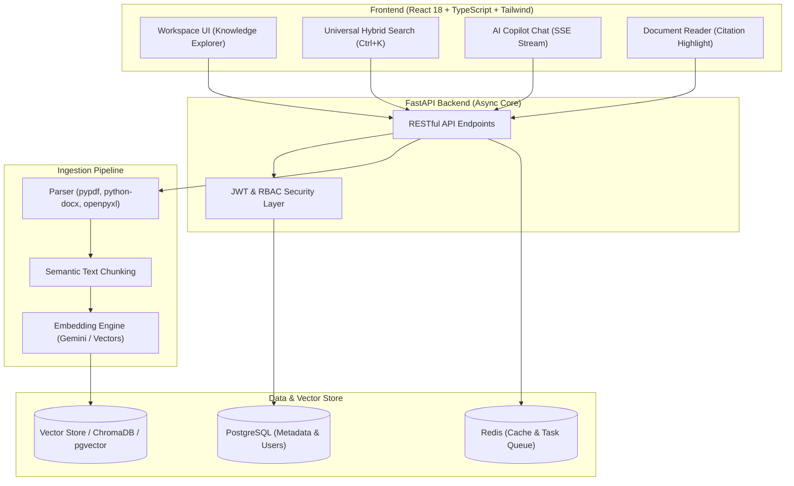

# 🧠 DocuMind — Enterprise Knowledge Base & Verifiable AI Retrieval System

<p align="center">
  
  
  
  
  
  
  
  
</p>

---

## 📌 1. Giới Thiệu (Overview)

**DocuMind** là nền tảng quản trị tri thức doanh nghiệp thế hệ mới kết hợp trí tuệ nhân tạo (AI-Powered Knowledge Management), giải quyết triệt để bài toán "dữ liệu chết" khi hàng nghìn tài liệu nội bộ (PDF, Word, Excel) bị phân tán trên Google Drive, email và máy tính cá nhân.

Khác với các chatbot AI thông thường (chỉ là lớp vỏ bọc API mỏng và dễ bị ảo giác), **DocuMind được xây dựng theo chuẩn mực Enterprise**:
1. **Phân quyền đa tầng (RBAC & Department Isolation):** Dữ liệu phòng Nhân sự, Kế toán, Kỹ thuật được cách ly an toàn. Nhân viên phòng A tuyệt đối không thể truy xuất tài liệu phòng B nếu không được cấp quyền.
2. **Tìm kiếm ngữ nghĩa lai (Hybrid Search):** Kết hợp thuật toán **BM25** (tìm chính xác số hiệu, mã văn bản) và **Dense Vector Search** (tìm theo ý nghĩa câu hỏi).
3. **Truy xuất có kiểm chứng (Verifiable Retrieval & Strict Grounding):** Mọi câu trả lời của AI đều gắn nhãn trích dẫn: `[Nguồn 1: Sổ tay nhân viên - Trang 12]`. Người dùng click vào nguồn sẽ tự động mở tài liệu và **tô sáng (highlight) đoạn văn gốc**.

---

## 🏛️ 2. Kiến Trúc Hệ Thống (Architecture)



---

## ✨ 3. Các Tính Năng Nổi Bật (Key Features)

* **Multi-format Ingestion:** Hỗ trợ nạp và bóc tách tài liệu PDF, DOCX (giữ nguyên phân cấp Heading), XLSX (giữ bảng và cột theo Sheet), Markdown và Text.
* **Semantic Chunking:** Không cắt văn bản theo số ký tự máy móc; hệ thống tự nhận diện điều khoản, mục lục và phân đoạn theo ngữ cảnh trọn vẹn.
* **Hybrid Search Engine:** Sử dụng công thức kết hợp điểm số BM25 và Vector Similarity:
  $$\text{Score} = \alpha \times \text{Score}_{\text{Vector}} + (1 - \alpha) \times \text{Score}_{\text{BM25}}$$
* **Verifiable Citation & Document Reader:** Trực quan hóa nguồn dẫn chứng, click vào trích dẫn sẽ mở đúng tài liệu, cuộn đến đúng trang và kích hoạt hiệu ứng highlight phát sáng.
* **Audit Trail & Observability:** Mọi hành vi đăng nhập, truy vấn AI, upload tài liệu đều được ghi nhận vào nhật ký kiểm toán bất biến (Audit Log).

---

## 🚀 4. Cài Đặt & Chạy Thử (Quick Start)

### Yêu cầu hệ thống:
* **Python 3.10+**
* **Node.js 18+** & npm
* **Docker & Docker Compose** (Tùy chọn)

### Cách 1: Chạy trực tiếp (Local Development)

#### 1. Khởi động Backend (FastAPI):
```bash
cd backend
python -m venv venv
# Trên Windows: venv\Scripts\activate
# Trên Linux/macOS: source venv/bin/activate

pip install -r requirements.txt
uvicorn app.main:app --reload --port 8000
```
* Swagger API Documentation: [http://localhost:8000/docs](http://localhost:8000/docs)

#### 2. Khởi động Frontend (React + Vite):
```bash
cd frontend
npm install
npm run dev
```
* Ứng dụng Web: [http://localhost:5173](http://localhost:5173)

---

### Cách 2: Chạy toàn bộ bằng Docker Compose
```bash
docker compose up --build
```

---

## 🧪 5. Kiểm Thử Hệ Thống (Testing & Security Verification)

Dự án đi kèm bộ test case tự động kiểm thử toàn diện các yêu cầu bảo mật trong tài liệu BA:
* **TC-SEC-01:** Kiểm thử cách ly dữ liệu giữa các phòng ban (Nhân viên HR không thể đọc tài liệu Tài chính mật).
* **TC-RAG-01:** Kiểm thử cơ chế **Strict Grounding** (AI từ chối trả lời khi không có nguồn hợp lệ).
* **TC-SEARCH-01:** Kiểm thử thuật toán Hybrid Search (BM25 + Semantic Search).

Chạy toàn bộ test suite bằng lệnh:
```bash
cd backend
pytest
```

---

## 📄 6. Tài Liệu Nghiệp Vụ (BA Specification)
Đặc tả phân tích nghiệp vụ chi tiết 13 phần (12 phân hệ chức năng P0/P1, Ma trận phân quyền, KPIs, Luồng End-to-End) được lưu trữ tại:
👉 [docs/BUSINESS_ANALYSIS.md](docs/BUSINESS_ANALYSIS.md)

---

## 👤 Tác Giả & Bản Quyền
* **Tác giả:** Lê Thiên Phú (Khoa Công nghệ Thông tin - Trường ĐH Kinh tế Quốc dân)
* **Giấy phép:** MIT License
